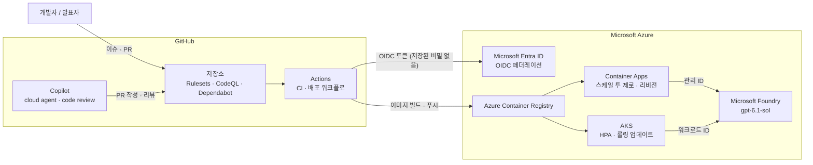

# Cloud Copilot Demo — GitHub × Microsoft Azure 발표용 데모 키트

GitHub Copilot, GitHub(저장소·Actions), Microsoft Foundry, Azure Container Apps, AKS의 장점을 작은 앱 하나로 보여 주는 데모 키트입니다. 앱은 Microsoft Foundry의 gpt-6.1-sol로 질문에 답하고, 어느 플랫폼의 어느 리비전·인스턴스가 응답했는지 화면에 함께 보여 줍니다. 데모 6개는 각각 따로 시연할 수 있고, 발표 슬라이드와 시연 순서가 함께 들어 있습니다.

> **먼저 읽어 주세요**
>
> - **검증 범위**: 코드와 스크립트는 로컬 실행(단위 테스트, 컨테이너 빌드와 스모크 테스트)과 정적 검사(Bicep 빌드, kubeconform, actionlint, shellcheck, hadolint)로 확인했습니다. 실제 Azure 구독에 배포하는 시연은 이 키트를 만드는 단계에서 실행하지 않았습니다. 첫 발표 전에 반드시 한 번 리허설하세요.
> - **자리 표시자**: 꺾쇠(`<>`) 안은 자신의 값으로 바꾸는 자리 표시자입니다. 예를 들어 `<owner/name>`은 `junwoojeong100/ghcp-in-the-cloud`처럼 바꿉니다.
> - **화면 이름**: UI 메뉴 이름은 변경될 수 있음을 염두에 두세요. 화면이 다르면 문서에 적힌 CLI 명령이나 설정 이름을 기준으로 찾으세요.
> - **실행 환경**: 스크립트는 bash 4 이상이 필요합니다. macOS의 기본 bash는 3.2라서 `brew install bash`로 설치하세요. Windows에서는 WSL2나 Codespaces에서 실행하세요.

## 서비스별 이점

| 서비스 | 이 키트가 보여 주는 이점 | 데모 |
|---|---|---|
| GitHub Copilot | 이슈를 AI 팀원(cloud agent)에게 맡겨 PR로 받고, 저장소 지침으로 결과의 품질과 범위를 통제합니다. | 1 |
| GitHub 저장소 | 브랜치 보호(Rulesets), 코드 오너, CodeQL, Dependabot, Codespaces를 파일과 스크립트로 정의합니다. | 2 |
| GitHub Actions | PR마다 병렬 검증하고, 저장된 비밀 없이 OIDC로 Azure에 배포하며, 환경 승인으로 배포를 통제합니다. | 3 |
| Microsoft Foundry | 같은 앱 코드가 API 키 없이 Microsoft Entra ID로 모델(gpt-6.1-sol)을 호출합니다. 모델 배포와 effort는 설정으로 바꿉니다. | 4 |
| Azure Container Apps | 클러스터 운영 없이 HTTPS 서비스를 올립니다. 요청이 없으면 0으로 줄고, 리비전으로 카나리 배포를 합니다. | 5 |
| AKS | 무중단 롤링 업데이트, HPA 자동 확장, 워크로드 ID, Pod Security 기본값을 보여 줍니다. | 6 |

## 데모 목록

| # | 데모 | 한 줄 요약 | 시간 | 필요한 것 |
|---|---|---|---|---|
| 1 | [GitHub Copilot](demos/01-github-copilot/README.md) | 이슈 → 에이전트 PR → CI → Copilot code review → 사람 리뷰와 merge | 약 7분 | GitHub 저장소, Copilot 라이선스 |
| 2 | [GitHub Repo](demos/02-github-repo/README.md) | main 보호와 보안 설정을 코드로 정의하고, 위험한 PR이 검사에 걸리는 모습 확인 | 약 6분 | GitHub 저장소(관리자 권한) |
| 3 | [GitHub Actions](demos/03-github-actions/README.md) | 병렬 CI와 비밀 없는 OIDC 배포 | 약 7분 | GitHub 저장소(1단계), Azure 구독(2~3단계) |
| 4 | [Microsoft Foundry](demos/04-microsoft-foundry/README.md) | gpt-6.1-sol 배포와 키 없는 호출 | 약 7분 | Azure 구독 |
| 5 | [Azure Container Apps](demos/05-azure-container-apps/README.md) | 스케일 투 제로, 리비전 카나리, 부하에 따른 스케일 아웃 | 약 7분 | Azure 구독 |
| 6 | [AKS](demos/06-aks/README.md) | 롤링 업데이트, HPA, 워크로드 ID, 보안 기본값 | 약 8분 | Azure 구독 |

전부 이어서 시연하면 약 42분입니다. 15분짜리 요약 코스와 시간표는 [DEMO_GUIDE_KO.md](DEMO_GUIDE_KO.md)에 있습니다. 각 데모 문서는 같은 틀(한눈에 보기, 사전 준비, 시연 순서, 말하기 포인트, 정리, 문제 해결)로 쓰여 있어 해당 문서만 열어도 시연할 수 있습니다.

## 아키텍처



- 배포 경로: Actions가 GitHub OIDC 토큰으로 Azure에 로그인하고(저장된 자격 증명 없음) 이미지를 ACR에 올립니다. Container Apps와 AKS는 ACR에서 이미지를 받습니다.
- 모델 호출 경로: 앱은 비밀 대신 플랫폼이 주는 ID로 Foundry를 부릅니다. Container Apps는 관리 ID, AKS는 워크로드 ID를 쓰고, 로컬에서는 `az login`한 사용자 자격을 씁니다. 코드는 모두 `DefaultAzureCredential` 하나입니다.
- Foundry와 Azure 없이도 `LLM_BACKEND=mock`으로 앱 전체를 실행할 수 있습니다. 이 모드는 CI와 데모 5·6의 기본값입니다.

## 독립 실행 매트릭스

어느 데모든 다른 데모를 먼저 할 필요가 없습니다. 필요한 것만 준비하면 됩니다.

| 데모 | GitHub 저장소 | Copilot 라이선스 | Azure 구독 | 먼저 해야 하는 데모 |
|---|---|---|---|---|
| 1 Copilot | 필요 | 필요(cloud agent) | 불필요(선택 단계의 Azure MCP 질의만 `az login`) | 없음 |
| 2 Repo | 필요(관리자 권한) | 3단계의 Copilot code review에만 | 불필요 | 없음 |
| 3 Actions | 필요 | 불필요 | 2~3단계만 필요 | 없음. 배포 대상은 `scripts/deploy-aca.sh`로 만들면 되고 Demo 5를 따라 할 필요는 없습니다. |
| 4 Foundry | 불필요 | 불필요 | 필요(gpt-6.1-sol 쿼터가 있는 구독) | 없음 |
| 5 Container Apps | 불필요 | 불필요 | 필요 | 없음. Foundry 연결은 선택입니다. |
| 6 AKS | 불필요 | 불필요 | 필요 | 없음. Foundry 연결은 선택입니다. |

## 빠른 시작 (Azure 없이)

Python 3.12가 필요합니다. 아래 명령은 저장소 루트에서 실행합니다.

```bash
git clone https://github.com/junwoojeong100/ghcp-in-the-cloud.git
cd ghcp-in-the-cloud

# 1) 단위 테스트
python -m unittest discover -s app/tests -v

# 2) 앱 실행 (mock 백엔드, Azure 불필요)
export DEMO_PASSWORD='<로컬에서만 쓸 임시 값>'
LLM_BACKEND=mock python -m app.server
```

앱이 뜨면 브라우저에서 `http://127.0.0.1:8080`을 열고 사용자 이름 `demo`, 비밀번호는 `DEMO_PASSWORD` 값으로 로그인합니다. 포크했다면 `git clone` 주소를 자신의 저장소 주소로 바꾸세요. `LLM_BACKEND`의 기본값은 `foundry`이므로 로컬에서는 `mock`을 꼭 지정해야 합니다.

다른 터미널에서 같은 `DEMO_PASSWORD`를 내보낸 뒤 스모크 테스트를 실행합니다.

```bash
scripts/smoke-test.sh
```

마지막에 `모든 확인(…)을 통과했습니다.` 줄이 나오면 헬스 체크, 인증, 채팅 왕복, 잘못된 입력 처리, 보안 헤더가 모두 정상입니다. 주소를 인자로 주면 배포된 앱도 같은 방식으로 확인합니다.

컨테이너로 실행하려면 이렇게 합니다.

```bash
docker build --file app/Dockerfile --tag cloud-copilot-demo .
docker run --rm --publish 127.0.0.1:8080:8080 \
  --env LLM_BACKEND=mock --env DEMO_PASSWORD \
  cloud-copilot-demo
```

`--env DEMO_PASSWORD`는 앞에서 내보낸 값을 그대로 넘깁니다. 비밀번호가 명령줄에 남지 않습니다.

CI와 같은 검사 도구(kubeconform, actionlint, hadolint)는 `scripts/install-dev-tools.sh`로 설치합니다(Linux 전용, 버전 고정과 SHA-256 검증). `--dir <경로>`로 설치 위치를, 도구 이름으로 설치할 도구를 고를 수 있습니다. Codespaces나 dev container에서 열면 `post-create.sh`가 같은 도구를 자동으로 설치합니다.

```bash
scripts/install-dev-tools.sh --dir "$HOME/.local/bin"
```

## Azure 배포와 설정 스크립트

모든 스크립트는 `--help`로 사용법과 환경 변수를 보여 줍니다. 리소스를 만들거나 바꾸는 스크립트는 실행 전에 확인을 묻거나(`--yes`로 생략) 기본이 dry-run입니다(`--apply`를 붙여야 적용).

| 하는 일 | 명령 | 관련 데모 |
|---|---|---|
| 시연용 이슈 만들기(선택: Copilot에게 할당) | `scripts/create-demo-issues.sh [--apply] [--assign-copilot]` | 1 |
| 저장소 보안·룰셋·머지 옵션 적용 | `scripts/apply-repo-settings.sh [--apply]` | 2 |
| 위험한 PR 만들기 | `demos/02-github-repo/risky-pr/make-risky-pr.sh` | 2 |
| GitHub Actions용 OIDC 연동 | `scripts/setup-github-oidc.sh [--apply]` | 3 |
| Foundry에 모델 배포(기본 gpt-6.1-sol) | `scripts/deploy-foundry.sh` (Claude는 `MODEL_NAME=claude-sonnet-5-5 CLAUDE_ORGANIZATION_NAME="<조직 이름>"`) | 4 |
| Container Apps 배포 | `scripts/deploy-aca.sh` | 5 |
| 리비전 카나리 (`status`, `deploy`, `canary`, `promote`, `rollback`, `probe`, `urls`) | `scripts/aca-canary.sh <명령>` | 5 |
| 부하 생성 | `scripts/load-test.sh --url <앱 주소>` | 5 |
| AKS 배포 | `scripts/deploy-aks.sh` | 6 |
| 배포된 앱 점검 | `scripts/smoke-test.sh [앱 주소]` | 3~6 |
| 만든 리소스 정리 | `scripts/cleanup.sh <aca\|aks\|foundry\|oidc\|all>` | 전체 |

Foundry의 모델을 앱에 연결하려면 `scripts/deploy-foundry.sh`를 먼저 실행하고 `source .azure/foundry.env`를 한 뒤 `scripts/deploy-aca.sh` 또는 `scripts/deploy-aks.sh`를 실행합니다. 이 파일에는 백엔드, Foundry 리소스 이름, 배포 이름처럼 비밀이 아닌 값만 들어 있고 `.gitignore`에도 등록돼 있습니다. 자세한 흐름은 [Demo 4](demos/04-microsoft-foundry/README.md)에 있습니다.

## 엔드포인트

앱은 표준 라이브러리 `http.server`로 만든 서버 하나와 HTML 한 장입니다.

| 경로 | 메서드 | 인증 | 설명 |
|---|---|---|---|
| `/healthz` | GET | 없음 | 플랫폼 프로브용 상태 확인입니다. 항상 `{"status": "ok"}`를 돌려줍니다. 인증이 필요 없는 유일한 경로입니다. |
| `/` | GET | Basic | 채팅 화면입니다. 응답한 플랫폼, 인스턴스, 리비전, 앱 버전, 모델, effort, 인증 방식, 백엔드를 칩으로 보여 주고, "트래픽 분포 보기" 버튼이 20번 호출해 리비전별·인스턴스별·버전별 응답 수를 셉니다. |
| `/api/info` | GET | Basic | 런타임 정보입니다. `app`, `backend`, `model`, `effort`, `auth`, `platform`, `instance`, `revision`, `version`을 JSON으로 돌려줍니다. mock 백엔드에서는 `model`이 `mock`이고 `effort`는 `null`입니다. |
| `/api/chat` | POST | Basic | 본문 `{"message": "<질문>"}`(1~2000자)을 받아 `{"answer": "...", "served_by": {"instance", "revision", "version"}}`을 돌려줍니다. 빈 메시지는 400입니다. |

인증은 HTTP Basic입니다. 사용자 이름은 `demo`이고 비밀번호는 `DEMO_PASSWORD`입니다. `DEMO_PASSWORD`가 없으면 `/healthz`를 뺀 모든 경로가 503으로 막힙니다. 비밀번호는 요청 본문을 읽기 전에 검사하고, 로그에 남기지 않습니다.

```bash
curl -u "demo:$DEMO_PASSWORD" http://127.0.0.1:8080/api/info
curl -u "demo:$DEMO_PASSWORD" -H 'Content-Type: application/json' \
  -d '{"message":"안녕하세요"}' http://127.0.0.1:8080/api/chat
```

## 환경 변수

앱이 읽는 환경 변수입니다. 괄호는 기본값입니다. 배포 스크립트가 쓰는 변수는 각 스크립트의 `--help`에 있습니다.

| 변수 | 설명 |
|---|---|
| `DEMO_PASSWORD` | Basic 인증 비밀번호(사용자 이름은 `demo`). 없으면 `/healthz`를 뺀 모든 경로가 503입니다. 코드나 문서에 값을 쓰지 말고 환경 변수나 플랫폼 비밀로만 넘기세요. |
| `LLM_BACKEND` | `foundry` 또는 `mock`(`foundry`). `mock`은 Azure 없이 정해진 답을 돌려줍니다. |
| `FOUNDRY_RESOURCE` | Foundry 리소스 **이름**(주소가 아닙니다). `LLM_BACKEND=foundry`일 때 필수입니다. |
| `FOUNDRY_MODEL` | Foundry의 모델 **배포 이름**(`gpt-6.1-sol`). 모델 ID가 아니라 배포 이름입니다. |
| `FOUNDRY_PROVIDER` | `openai` 또는 `anthropic`. 비우면 배포 이름이 `claude`로 시작할 때만 `anthropic`(Anthropic SDK), 아니면 `openai`(OpenAI 호환 v1 엔드포인트, 표준 라이브러리만 사용)입니다. |
| `FOUNDRY_EFFORT` | `low` · `medium` · `high` · `xhigh` · `max`(`max`). gpt-6.1-sol에는 `max`가 없어서 `xhigh`로 보내고, `/api/info`도 `xhigh`로 보여 줍니다. |
| `FOUNDRY_MAX_TOKENS` | 응답의 최대 토큰 수, 256~16000(`4096`). |
| `FOUNDRY_API_KEY` | 선택. 지정하면 API 키로 인증하고(`/api/info`의 `auth`가 `api-key`), 없으면 Microsoft Entra ID(`DefaultAzureCredential`)를 씁니다(`entra-id`). 이 데모는 키 없는 방식을 권장합니다. |
| `ANTHROPIC_FOUNDRY_API_KEY` | `FOUNDRY_API_KEY`의 이전 이름입니다. 둘 다 있으면 `FOUNDRY_API_KEY`를 씁니다. |
| `MOCK_LATENCY_MS` | mock 응답 지연, 0~10000(`0`). 배포 스크립트는 스케일 아웃을 보여 주려고 `1000`으로 지정합니다. |
| `APP_VERSION` | 화면과 `/api/info`에 보이는 앱 버전(`dev`). 컨테이너 이미지는 빌드할 때 `--build-arg APP_VERSION=<태그>`로 넣습니다. |
| `APP_PLATFORM` | 실행 플랫폼 표시. 지정하지 않으면 Container Apps(`CONTAINER_APP_NAME`)와 AKS(`KUBERNETES_SERVICE_HOST`)를 자동으로 알아냅니다. |
| `HOST`, `PORT` | 서버 주소와 포트(`127.0.0.1`, `8080`). 컨테이너 이미지는 `HOST=0.0.0.0`으로 실행됩니다. |

## 저장소 구성

```text
app/                  데모 앱: server.py, index.html, Dockerfile, tests/
infra/
  foundry/            Foundry 계정, 프로젝트, 모델 배포 (Bicep)
  aca/                Container Apps 환경과 앱, ACR, 관리 ID (Bicep)
  aks/                AKS 클러스터와 ACR (Bicep), k8s/ 매니페스트(Kustomize)
  modules/            공용 Bicep 모듈(Foundry 접근 권한)
scripts/              배포, 카나리, 부하, 스모크 테스트, 정리 스크립트(bash)
demos/                01~06 데모별 시연 문서와 보조 파일
slides/               발표 슬라이드(PPTX), 슬라이드별 진행 대본(Markdown), 생성 스크립트
docs/                 녹화 데모 슬라이드를 게시하는 GitHub Pages 소개 페이지(PPTX는 릴리스 파일)
.github/
  workflows/          ci, codeql, dependency-review, deploy-aca, deploy-aks, copilot-setup-steps, pages
  copilot-instructions.md, instructions/, prompts/, agents/    Copilot 설정(Demo 1)
  rulesets/, CODEOWNERS, dependabot.yml, 템플릿             저장소 거버넌스(Demo 2)
.devcontainer/        Codespaces와 dev container 설정
.vscode/              Copilot MCP 서버와 권장 확장
```

## 비용, 보안, 정리

- **비용**: Azure 리소스는 켜 둔 시간만큼 비용이 듭니다. 특히 AKS 노드는 계속 과금되고, Foundry 모델은 호출한 만큼 과금됩니다. 가격은 바뀌므로 문서에 적지 않았습니다. 시연 직전에 만들고 직후에 지우세요.
- **정리**: `scripts/cleanup.sh all`이 이 키트가 만든 리소스 그룹, GitHub Actions용 관리 ID, `azure-demo` 환경 변수를 지웁니다. `demo=ghcp-in-the-cloud` 태그가 없는 리소스 그룹은 지우지 않습니다. 일부만 지우려면 `aca`, `aks`, `foundry`, `oidc`를 지정하세요.
- **비밀 없음**: 저장소에는 비밀이 없습니다. GitHub Actions는 OIDC로, 앱은 관리 ID·워크로드 ID로 인증합니다. 데모 비밀번호는 스크립트가 생성해 마지막에 한 번 보여 주고(환경 변수로 지정도 가능), 클라우드에서는 플랫폼 비밀에 저장됩니다.
- **공개 접근**: Container Apps 앱은 인터넷에서 접근할 수 있으므로 시연 후 바로 지우세요. 앱은 `/healthz` 외 모든 경로에 Basic 인증을 걸지만, 데모용 보호 수준입니다.
- **위험한 PR**: Demo 2의 PR은 일부러 취약하게 만든 파일을 담고 있습니다. 시연 후 닫고 브랜치를 지우며 절대 merge하지 마세요.

## 발표 자료와 가이드

- [DEMO_GUIDE_KO.md](DEMO_GUIDE_KO.md): 전체 코스(약 42분)와 요약 코스(약 15분), 시연 전 체크리스트, 시간표
- [slides/](slides/): 발표 슬라이드(`demo-presentation-ko.pptx`, 모든 슬라이드에 발표자 노트 포함)와 슬라이드별 진행 대본(`demo-presentation-ko.md`). 데모마다 가치, 시연 흐름, 핵심 코드 세 장으로 구성했습니다. 두 파일은 `slides/build_deck.py`가 같은 데이터로 만들며, 고칠 때는 스크립트를 수정한 뒤 `pip install -r slides/requirements.txt`와 `python slides/build_deck.py`를 실행합니다. 데모 앱과는 별개인 도구이므로 데모를 실행하는 데는 필요 없습니다.
- [demos/](demos/): 데모별 시연 문서

## 문제 해결

| 증상 | 확인할 것 |
|---|---|
| 채팅이 503 `The service is not configured`를 돌려줌 | 응답의 `hint`를 읽어 보세요. 로컬에서 Azure 없이 쓰려면 `LLM_BACKEND=mock`을 지정합니다. 기본값이 `foundry`라서 `FOUNDRY_RESOURCE`가 없으면 이 오류가 납니다. |
| 모든 요청이 503 `Demo access is not configured` | `DEMO_PASSWORD`를 내보냈는지 확인하세요. |
| 스크립트가 `bash 4 이상이 필요합니다`라며 종료 | macOS에서는 `brew install bash`로 새 bash를 설치하고 다시 실행하세요. |
| `docker run`이 8080 포트 충돌을 냄 | 로컬에서 실행 중인 앱을 끄거나 `--publish 127.0.0.1:8081:8080`처럼 호스트 포트를 바꾸세요. 이때 `scripts/smoke-test.sh http://127.0.0.1:8081`로 확인합니다. |
| Azure 스크립트가 로그인이나 권한 오류를 냄 | `az login`과 구독 선택을 확인하세요. 배포는 리소스 그룹과 역할 할당을 만들므로 구독 Owner, 또는 Contributor와 User Access Administrator 권한이 필요합니다. |

## 라이선스

[MIT License](LICENSE)
