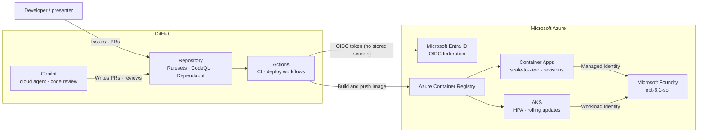

# Cloud Copilot Demo — A Demo Kit for GitHub × Microsoft Azure Presentations

**English** · [한국어](../README.md)

A demo kit that shows the strengths of GitHub Copilot, GitHub (repositories and Actions), Microsoft Foundry, Azure Container Apps and AKS with one small app. The app answers questions with gpt-6.1-sol on Microsoft Foundry and shows on screen which revision and instance on which platform answered. You can show each of the six demos on its own, and the presentation slides and the demo steps are included.

This is the English edition: the guides, the presentation slides, a recorded demo (video and slides) and a web page for it. The code, scripts and infrastructure are shared with the Korean edition and live at the repository root. [Slides and guides](#slides-and-guides) lists every English file.

> **Read this first**
>
> - **What was verified**: The code and scripts were checked with local runs (unit tests, a container build and a smoke test) and static checks (Bicep build, kubeconform, actionlint, shellcheck, hadolint). The demos that deploy to a real Azure subscription were run end to end on practice repositories and recorded ([Slides and guides](#slides-and-guides)). Results can differ with your subscription and permissions, so be sure to rehearse once before your first talk.
> - **Placeholders**: Text in angle brackets (`<>`) is a placeholder for your own value. For example, replace `<owner/name>` with something like `junwoojeong100/ghcp-in-the-cloud`.
> - **Screen names**: Portal menu names may change. If a screen looks different, search by the CLI command or the setting name given in the document.
> - **Runtime**: The scripts need bash 4 or later. The default bash on macOS is 3.2, so install a newer one with `brew install bash`. On Windows, run them in WSL2 or Codespaces.
> - **Language**: The guides are in English, but the app and the scripts in this repository are in Korean: the chat page labels, the messages the scripts print and the model's answers. [Language of the app and the scripts](#language-of-the-app-and-the-scripts) lists the Korean text the guides refer to.

## Benefits by service

| Service | What this kit shows | Demo |
|---|---|---|
| GitHub Copilot | Hand an issue to an AI teammate (the cloud agent), receive a PR, and control the quality and scope of the result with repository instructions. | 1 |
| GitHub repository | Branch protection (Rulesets), code owners, CodeQL, Dependabot and Codespaces, defined as files and scripts. | 2 |
| GitHub Actions | Parallel verification on every PR, deployment to Azure with OIDC and no stored secrets, and deployment control through environment approvals. | 3 |
| Microsoft Foundry | The same app code calls the model (gpt-6.1-sol) through Microsoft Entra ID, with no API key. You change the model deployment and the effort through settings. | 4 |
| Azure Container Apps | Run an HTTPS service without operating a cluster. Scale-to-zero stops the replicas when there are no requests, and canary deployments use revisions. | 5 |
| AKS | Zero-downtime rolling updates, HPA autoscaling, Workload Identity and Pod Security defaults. | 6 |

## Demo list

| # | Demo | In one line | Time | What you need |
|---|---|---|---|---|
| 1 | [GitHub Copilot](demos/01-github-copilot/README.md) | Issue → agent PR → CI → Copilot code review → human review and merge | About 7 min | A GitHub repository, a Copilot license |
| 2 | [GitHub Repo](demos/02-github-repo/README.md) | Define main protection and security settings as code, and see a risky PR get caught by the checks | About 6 min | A GitHub repository (admin access) |
| 3 | [GitHub Actions](demos/03-github-actions/README.md) | Parallel CI and OIDC deployment without secrets | About 7 min | A GitHub repository (step 1), an Azure subscription (steps 2–3) |
| 4 | [Microsoft Foundry](demos/04-microsoft-foundry/README.md) | Deploy gpt-6.1-sol and call it without keys | About 7 min | An Azure subscription |
| 5 | [Azure Container Apps](demos/05-azure-container-apps/README.md) | Scale-to-zero, revision canary, scale-out under load | About 7 min | An Azure subscription |
| 6 | [AKS](demos/06-aks/README.md) | Rolling updates, HPA, Workload Identity, secure defaults | About 8 min | An Azure subscription |

Running all of them back to back takes about 42 minutes. The 15-minute Lite course and the timetable are in [DEMO_GUIDE.md](DEMO_GUIDE.md). Every demo guide follows the same outline (At a glance, Prerequisites, Demo steps, Talking points, Cleanup, Troubleshooting), so you can open just that guide and run the demo.

## Architecture



- Deployment path: Actions logs in to Azure with the GitHub OIDC token (no stored credentials) and pushes the image to ACR. Container Apps and AKS pull the image from ACR.
- Model call path: The app calls Foundry with the identity the platform provides instead of a secret. Container Apps uses a Managed Identity, AKS uses a Workload Identity, and locally the app uses the credential of the user who ran `az login`. The code is the same `DefaultAzureCredential` everywhere.
- You can run the whole app without Foundry and Azure with `LLM_BACKEND=mock`. This mode is the default for CI and for Demos 5 and 6.

## Standalone matrix

You do not need to do any other demo before a given one. Prepare only what you need.

| Demo | GitHub repository | Copilot license | Azure subscription | Demo to do first |
|---|---|---|---|---|
| 1 Copilot | Required | Required (cloud agent) | Not needed (only the optional Azure MCP query needs `az login`) | None |
| 2 Repo | Required (admin access) | Only for Copilot code review in step 3 | Not needed | None |
| 3 Actions | Required | Not needed | Only for steps 2–3 | None. You can create the deployment target with `scripts/deploy-aca.sh`; you do not have to follow Demo 5. |
| 4 Foundry | Not needed | Not needed | Required (a subscription with gpt-6.1-sol quota) | None |
| 5 Container Apps | Not needed | Not needed | Required | None. Connecting Foundry is optional. |
| 6 AKS | Not needed | Not needed | Required | None. Connecting Foundry is optional. |

## Quick start (without Azure)

You need Python 3.12. Run the commands below from the repository root.

```bash
git clone https://github.com/junwoojeong100/ghcp-in-the-cloud.git
cd ghcp-in-the-cloud

# 1) Unit tests
python -m unittest discover -s app/tests -v

# 2) Run the app (mock backend, no Azure needed)
export DEMO_PASSWORD='<a temporary value for local use only>'
LLM_BACKEND=mock python -m app.server
```

When the app is up, open `http://127.0.0.1:8080` in a browser and sign in with the user name `demo` and the value of `DEMO_PASSWORD` as the password. If you forked the repository, replace the `git clone` URL with your own repository URL. The default of `LLM_BACKEND` is `foundry`, so you must set `mock` for local runs.

In another terminal, export the same `DEMO_PASSWORD` and run the smoke test.

```bash
scripts/smoke-test.sh
```

When the last line says that all checks passed (`모든 확인(<n>개)을 통과했습니다.` in this repository's Korean script messages), the health check, authentication, the chat round trip, invalid input handling and the security headers are all fine. If you pass a URL as an argument, it checks a deployed app in the same way.

To run it in a container:

```bash
docker build --file app/Dockerfile --tag cloud-copilot-demo .
docker run --rm --publish 127.0.0.1:8080:8080 \
  --env LLM_BACKEND=mock --env DEMO_PASSWORD \
  cloud-copilot-demo
```

`--env DEMO_PASSWORD` passes through the value you exported earlier, so the password does not stay on the command line.

Install the same check tools as CI (kubeconform, actionlint, hadolint) with `scripts/install-dev-tools.sh` (Linux only, pinned versions and SHA-256 verification). `--dir <path>` sets the install location, and you can choose which tools to install by name. In Codespaces or a dev container, `post-create.sh` installs the same tools automatically.

```bash
scripts/install-dev-tools.sh --dir "$HOME/.local/bin"
```

## Azure deployment and setup scripts

Every script shows its usage and environment variables with `--help`. A script that creates or changes resources either asks for confirmation before it runs (skip it with `--yes`) or is dry-run by default (add `--apply` to apply).

| What it does | Command | Related demo |
|---|---|---|
| Create the demo issues (optional: assign to Copilot) | `scripts/create-demo-issues.sh [--apply] [--assign-copilot]` | 1 |
| Apply repository security, ruleset and merge options | `scripts/apply-repo-settings.sh [--apply]` | 2 |
| Create a risky PR | `demos/02-github-repo/risky-pr/make-risky-pr.sh` | 2 |
| Set up OIDC for GitHub Actions | `scripts/setup-github-oidc.sh [--apply]` | 3 |
| Deploy a model to Foundry (default gpt-6.1-sol) | `scripts/deploy-foundry.sh` (for Claude: `MODEL_NAME=claude-sonnet-5-5 CLAUDE_ORGANIZATION_NAME="<organization name>"`) | 4 |
| Deploy to Container Apps | `scripts/deploy-aca.sh` | 5 |
| Revision canary (`status`, `deploy`, `canary`, `promote`, `rollback`, `probe`, `urls`) | `scripts/aca-canary.sh <command>` | 5 |
| Generate load | `scripts/load-test.sh --url <app URL>` | 5 |
| Deploy to AKS | `scripts/deploy-aks.sh` | 6 |
| Check a deployed app | `scripts/smoke-test.sh [app URL]` | 3–6 |
| Clean up the resources it created | `scripts/cleanup.sh <aca\|aks\|foundry\|oidc\|all>` | All |

To connect a Foundry model to the app, run `scripts/deploy-foundry.sh` first, run `source .azure/foundry.env`, and then run `scripts/deploy-aca.sh` or `scripts/deploy-aks.sh`. This file has only non-secret values such as the backend, the Foundry resource name and the deployment name, and it is listed in `.gitignore`. The detailed flow is in [Demo 4](demos/04-microsoft-foundry/README.md).

## Endpoints

The app is one server built on the standard library `http.server` and one HTML page.

| Path | Method | Auth | Description |
|---|---|---|---|
| `/healthz` | GET | None | Health check for platform probes. It always returns `{"status": "ok"}`. It is the only route that needs no authentication. |
| `/` | GET | Basic | The chat page. It shows the platform, instance, revision, version, model, effort, authentication method and backend that answered as chips, and the "Show traffic distribution" button makes 20 calls and counts the responses per revision, per instance and per version. |
| `/api/info` | GET | Basic | Runtime information. It returns `app`, `backend`, `model`, `effort`, `auth`, `platform`, `instance`, `revision` and `version` as JSON. With the mock backend, `model` is `mock` and `effort` is `null`. |
| `/api/chat` | POST | Basic | It takes the body `{"message": "<question>"}` (1–2000 characters) and returns `{"answer": "...", "served_by": {"instance", "revision", "version"}}`. An empty message returns 400. |

Authentication is HTTP Basic. The user name is `demo` and the password is `DEMO_PASSWORD`. If `DEMO_PASSWORD` is not set, every route except `/healthz` is blocked with 503. The password is checked before the request body is read, and it is not written to logs.

```bash
curl -u "demo:$DEMO_PASSWORD" http://127.0.0.1:8080/api/info
curl -u "demo:$DEMO_PASSWORD" -H 'Content-Type: application/json' \
  -d '{"message":"Hello"}' http://127.0.0.1:8080/api/chat
```

## Environment variables

These are the environment variables the app reads. Values in parentheses are defaults. The variables that the deploy scripts use are in each script's `--help`.

| Variable | Description |
|---|---|
| `DEMO_PASSWORD` | Password for Basic authentication (the user name is `demo`). Without it, every route except `/healthz` returns 503. Do not write the value in code or docs; pass it only as an environment variable or a platform secret. |
| `LLM_BACKEND` | `foundry` or `mock` (`foundry`). `mock` returns canned answers without Azure. |
| `FOUNDRY_RESOURCE` | The Foundry resource **name** (not a URL). Required when `LLM_BACKEND=foundry`. |
| `FOUNDRY_MODEL` | The model **deployment name** in Foundry (`gpt-6.1-sol`). It is the deployment name, not the model ID. |
| `FOUNDRY_PROVIDER` | `openai` or `anthropic`. If empty, it is `anthropic` (the Anthropic SDK) only when the deployment name starts with `claude`, and `openai` otherwise (the OpenAI-compatible v1 endpoint, standard library only). |
| `FOUNDRY_EFFORT` | `low` · `medium` · `high` · `xhigh` · `max` (`max`). gpt-6.1-sol has no `max`, so the app sends `xhigh` and `/api/info` also shows `xhigh`. |
| `FOUNDRY_MAX_TOKENS` | Maximum number of tokens in the response, 256–16000 (`4096`). |
| `FOUNDRY_API_KEY` | Optional. If set, the app authenticates with the API key (`auth` in `/api/info` is `api-key`). If not, it uses Microsoft Entra ID (`DefaultAzureCredential`) (`entra-id`). This demo recommends the keyless method. |
| `ANTHROPIC_FOUNDRY_API_KEY` | The former name of `FOUNDRY_API_KEY`. If both are set, `FOUNDRY_API_KEY` is used. |
| `MOCK_LATENCY_MS` | Mock response delay, 0–10000 (`0`). The deploy scripts set `1000` to show scale-out. |
| `APP_VERSION` | The app version shown in the UI and in `/api/info` (`dev`). For a container image, set it at build time with `--build-arg APP_VERSION=<tag>`. |
| `APP_PLATFORM` | The platform label. If not set, the app detects Container Apps (`CONTAINER_APP_NAME`) and AKS (`KUBERNETES_SERVICE_HOST`) automatically. |
| `HOST`, `PORT` | The server address and port (`127.0.0.1`, `8080`). The container image runs with `HOST=0.0.0.0`. |

## Repository layout

```text
app/                  The demo app: server.py, index.html, Dockerfile, tests/
infra/
  foundry/            Foundry account, project and model deployment (Bicep)
  aca/                Container Apps environment and app, ACR, Managed Identity (Bicep)
  aks/                AKS cluster and ACR (Bicep), k8s/ manifests (Kustomize)
  modules/            Shared Bicep modules (Foundry access permissions)
scripts/              Deploy, canary, load, smoke test and cleanup scripts (bash)
demos/                The Korean demo guide and helper files for each demo, 01–06
slides/               The Korean presentation slides (PPTX), per-slide scripts (Markdown), generator script
docs/                 GitHub Pages pages for the recorded demo, Korean and English (the PPTX and MP4 files are release assets)
en/                   This English edition: guides, presentation slides, generator script
.github/
  workflows/          ci, codeql, dependency-review, deploy-aca, deploy-aks, copilot-setup-steps, pages
  copilot-instructions.md, instructions/, prompts/, agents/    Copilot settings (Demo 1)
  rulesets/, CODEOWNERS, dependabot.yml, templates             Repository governance (Demo 2)
.devcontainer/        Codespaces and dev container settings
.vscode/              Copilot MCP servers and recommended extensions
```

## Cost, security and cleanup

- **Cost**: Azure resources cost money for as long as they are on. AKS nodes in particular are billed continuously, and Foundry models are billed per call. Prices change, so this document does not list them. Create resources right before the demo and delete them right after.
- **Cleanup**: `scripts/cleanup.sh all` deletes the resource groups this kit created, the Managed Identity for GitHub Actions and the `azure-demo` environment variables. It does not delete resource groups that lack the `demo=ghcp-in-the-cloud` tag. To delete only some of them, specify `aca`, `aks`, `foundry` or `oidc`.
- **No secrets**: The repository has no secrets. GitHub Actions authenticates with OIDC, and the app authenticates with a Managed Identity or a Workload Identity. The script generates the demo password and shows it once at the end (you can also set it with an environment variable), and in the cloud it is stored in a platform secret.
- **Public access**: A Container Apps app is reachable from the internet, so delete it right after the demo. The app puts Basic authentication on every route except `/healthz`, but this is demo-level protection.
- **The risky PR**: The PR in Demo 2 contains files that are vulnerable on purpose. Close it and delete the branch after the demo, and never merge it.

## Slides and guides

All English material of this kit is listed here. The video and the recorded-demo slides are too large for git, so they are assets of the release [`recorded-demo-slides`](https://github.com/junwoojeong100/ghcp-in-the-cloud/releases/tag/recorded-demo-slides), and the `Pages` workflow publishes them with the web page on GitHub Pages.

| What | Where |
|---|---|
| Demo guides (Markdown) | [DEMO_GUIDE.md](DEMO_GUIDE.md): the full course (about 42 minutes), the Lite course (about 15 minutes), the checklist to complete before you present, and the timetable. [demos/](demos/): one guide per demo. |
| Presentation slides for the live demos | [slides/](slides/): the presentation slides (`demo-presentation-en.pptx`, 37 slides, with speaker notes on every slide) and the per-slide script (`demo-presentation-en.md`). Each demo has four slides: value, demo flow, video and key code. `slides/build_deck.py` generates both files from the same data; see [slides/README.md](slides/README.md). This is a tool separate from the demo app, so you do not need it to run the demos. |
| Recorded demo: web page (HTML) | [junwoojeong100.github.io/ghcp-in-the-cloud/en/](https://junwoojeong100.github.io/ghcp-in-the-cloud/en/) has the video player with a chapter list and the links to the slides. The source is [`docs/en/index.html`](../docs/en/index.html). |
| Recorded demo: video | `ghcp-in-the-cloud-demo-en.mp4`, about 24 minutes, 1080p: [watch it on the web page](https://junwoojeong100.github.io/ghcp-in-the-cloud/en/) or [download it](https://github.com/junwoojeong100/ghcp-in-the-cloud/releases/download/recorded-demo-slides/ghcp-in-the-cloud-demo-en.mp4). The English captions are part of the picture. The same text as a transcript ([`.srt`](../docs/en/ghcp-in-the-cloud-demo-en.srt)) and the [chapter list](../docs/en/ghcp-in-the-cloud-demo-en.chapters.txt) are in `docs/en/`. |
| Recorded demo: slides | 45 slides with the 32 demo videos embedded: [open them in the Office web viewer](https://view.officeapps.live.com/op/view.aspx?src=https%3A%2F%2Fjunwoojeong100.github.io%2Fghcp-in-the-cloud%2FGHCP_in_the_Cloud_Demo_EN.pptx) (press ▶ on a slide to play its video) or [download the PPTX](https://junwoojeong100.github.io/ghcp-in-the-cloud/GHCP_in_the_Cloud_Demo_EN.pptx). The [Korean deck](https://view.officeapps.live.com/op/view.aspx?src=https%3A%2F%2Fjunwoojeong100.github.io%2Fghcp-in-the-cloud%2FGHCP_in_the_Cloud_Demo_KO.pptx) is in the same release. |

To replace a file of the recorded demo, upload the new file to the release with `gh release upload recorded-demo-slides <file> --clobber` and run the `Pages` workflow again.

## Source repository and practice repositories

This repository is the only source. Fix the code, infrastructure, scripts and guides here only, and give the demos in a **practice repository** that you create from this repository as a template. Demos 1–3 change repository settings, open PRs and merge the changes Copilot makes, and a practice repository keeps the source clean.

```bash
gh repo create <owner>/<name> --template junwoojeong100/ghcp-in-the-cloud --public --clone
```

When the demos are over, delete the practice repository altogether (`gh repo delete <owner>/<name>`). The checklist and the cleanup steps in [DEMO_GUIDE.md](DEMO_GUIDE.md) have the details.

`ghcp-in-the-cloud-practice` (Korean) and `ghcp-in-the-cloud-practice-en` (English), which you see in the recorded demos and slides, were the practice repositories used for the recordings. They no longer exist. The English recording used an English-localized copy of the app and the scripts that is not part of this repository. The last slide of the recorded English deck links to this repository, and the English guides are in this folder.

## Language of the app and the scripts

This edition translates the guides, the presentation slides and the recorded demo. The code is shared with the Korean edition, so in this repository the chat page, the mock backend's answers, the messages the scripts print and the model's answers are in Korean (the system prompt asks the model to answer in Korean). The screens in the English video and slides show English labels because the recording used the English-localized copy.

The guides name labels and messages by their English meaning. This table gives the text you will see in this repository.

| In the guides | In the app or the script output here |
|---|---|
| The info chips **Platform**, **Instance**, **Revision**, **Version**, **Model (deployment name)**, **Effort**, **Authentication** and **Backend** | `플랫폼`, `인스턴스`, `리비전`, `앱 버전`, `모델 (배포 이름)`, `effort`, `인증`, `백엔드` |
| The buttons **Refresh**, **Show traffic distribution (20 calls)** and **Ask** | `새로고침`, `트래픽 분포 보기 (20회 호출)`, `질문하기` |
| The last line of `scripts/smoke-test.sh`, "all `<n>` checks passed" | `모든 확인(<n>개)을 통과했습니다.` |
| The example questions and the answers | Korean |

The demo issues in [`en/demos/01-github-copilot/issues/`](demos/01-github-copilot/issues/) are the English versions of the Korean issue bodies in `demos/01-github-copilot/issues/`. `scripts/create-demo-issues.sh` reads only the Korean files. To create the issues in English, copy the three English files over the Korean ones in your practice repository first.

## Troubleshooting

| Symptom | What to check |
|---|---|
| Chat returns 503 `The service is not configured` | Read the `hint` in the response. To use the app locally without Azure, set `LLM_BACKEND=mock`. The default is `foundry`, so without `FOUNDRY_RESOURCE` you get this error. |
| Every request returns 503 `Demo access is not configured` | Check that you exported `DEMO_PASSWORD`. |
| A script exits with `bash 4 이상이 필요합니다` (bash 4 or later is required) | On macOS, install a new bash with `brew install bash` and run it again. |
| `docker run` reports a conflict on port 8080 | Stop the app running locally, or change the host port, as in `--publish 127.0.0.1:8081:8080`. Then check with `scripts/smoke-test.sh http://127.0.0.1:8081`. |
| An Azure script shows a login or permission error | Check `az login` and the subscription selection. A deployment creates resource groups and role assignments, so you need subscription Owner, or Contributor plus User Access Administrator. |

## License

[MIT License](../LICENSE)
